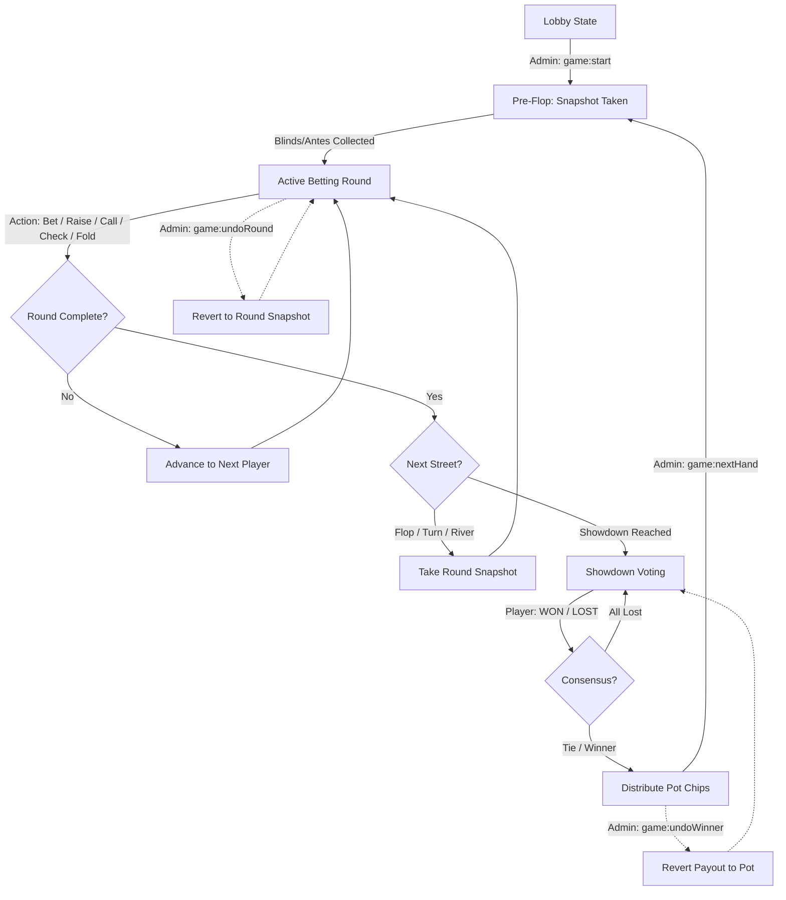

# 🃏 Real-Time Local Poker Engine

<div align="center">

[](https://nextjs.org/)
[](https://react.dev/)
[](https://nodejs.org/)
[](https://expressjs.com/)
[](https://socket.io/)
[](https://tailwindcss.com/)
[](#-architecture-overview)
[](LICENSE)

<p align="center">
  <strong>A high-performance, real-time companion dealer and chip ledger designed specifically for in-person Texas Hold'em games.</strong>
</p>

<p align="center">
  <a href="#-overview">Overview</a> •
  <a href="#-key-features">Key Features</a> •
  <a href="#-technology-stack">Tech Stack</a> •
  <a href="#-architecture-overview">Architecture</a> •
  <a href="#-game-mechanics--house-rules">Game Rules</a> •
  <a href="#-project-structure">Project Structure</a> •
  <a href="#-websocket-api-protocol">WebSocket API</a> •
  <a href="#-getting-started">Getting Started</a> •
  <a href="#-deployment-guide">Deployment</a>
</p>

</div>

---

> [!IMPORTANT]
> **No Virtual Cards Dealt:** This application does **not** generate or deal virtual playing cards. It is designed to run on players' smartphones and tablets during physical home games with real cards, serving as an authoritative digital dealer, pot calculator, stack tracker, turn timer, and synchronized room audio system.

---

## 📖 Overview

Organizing home poker nights often suffers from slow manual chip counting, confusing side-pot calculations, disputes over turn order, and players accidentally revealing actions out of turn.

**Poker Engine** replaces physical poker chips and manual bookkeeping with an ultra-responsive, real-time digital surface:
- Every player joins a room on their own mobile phone via a simple 4-digit room code.
- A long-running custom Node.js server coordinates turn orders, blinds, bets, raises, checks, and showdowns with sub-millisecond WebSocket updates.
- All game state lives completely in Node.js server RAM (`Map`), completely eliminating external database read/write roundtrips.
- An intelligent client-side audio engine synchronizes table background music across all devices in the physical room, backed by procedural Web Audio API sound cues.

---

## ✨ Key Features

### ⚡ Real-Time Turn Synchronization
- Native WebSockets powered by **Socket.io** provide instantaneous state broadcasts (`<1ms` internal loop latency).
- Action locks and `turnVersion` sequence counters prevent race conditions, duplicate bet submissions, and desynchronization.
- Automatic table orientation: on every player's mobile screen, the table automatically centers and docks their own seat at the bottom.

### 🧠 Zero-Database, Pure In-Memory State
- Bypasses external databases (no Postgres, MongoDB, or Redis) in favor of high-performance in-memory JavaScript `Map` structures.
- Instantaneous mutations for chip transactions, bets, and snapshot captures.
- **Auto-Cleanup / Self-Destruct:** The server monitors active connections; when the last player leaves or disconnects, room memory is automatically purged to prevent memory leaks.

### 🪙 Visual Chip Distribution & Greedy Algorithm
- **Denomination Engine:** Uses a greedy decomposition algorithm to convert any raw numeric balance into realistic, tappable chip denominations:
  - `10` (Cream), `50` (Orange), `100` (White/Stone), `500` (Red), `1,000` (Blue), `5,000` (Black), `10,000` (Purple), `50,000` (Gold), `100,000` (Platinum).
- **Dynamic Chip Trays:** Denominations exceeding a player's current stack are automatically disabled and greyed out.
- **Contribution Bubbles:** Live miniature chip stack icons render dynamically in player contribution bubbles across the table.
- **Two-Step Bet Confirmation:** Staging bets with chips requires a deliberate second confirmation tap to prevent misclicks on touchscreens.

### 🎛️ Custom House Rules & Sequence Modes
- **Blind Modes:**
  - `standard`: Traditional Small Blind (SB) and Big Blind (BB) forced bets with customizable stakes.
  - `ante_all`: Every player at the table contributes an ante, and action starts directly with the dealer.
- **Sequence Modes:**
  - `standard`: Traditional clockwise rotation of the dealer button after each hand.
  - `winner_curse`: A custom house rule where the winner of the previous hand is "cursed" to become the dealer on the next hand, pushing action to start directly to their left.

### 🤝 Democratic Showdown Consensus
- At the end of the river betting round, players enter the Showdown phase.
- Active participants tap **"I Won"** or **"I Lost"** based on their physical cards.
- The server evaluates votes automatically:
  - **Single Winner Consensus:** Full pot awarded instantly to the winning stack.
  - **Tie / Split Pot Consensus:** Pot evenly divided among winning players, with odd remainder chips distributed to the first winner.
  - **All-Lost Reset:** Automatically resets voting state if no player claims the hand.

### ⏪ Time-Machine Undo Engine
- Deep immutable state snapshots (`takeSnapshot`) are captured before forced bets and at the opening of each street (`pre-flop`, `flop`, `turn`, `river`).
- Admin controls include a one-tap **Undo Round** to revert erroneous bets and restore previous stack sizes.
- **Undo Winner** returns awarded chips from players back into the pot if a showdown was resolved mistakenly.

### 💳 Deferred Mid-Hand Chip Adjustments & Rebuys
- Players can adjust their chips (+/- quick increments of 100, 1,000, 5,000 or custom input) at any point.
- **Anti-Cheat Safe Delay:** If a player is active in an ongoing hand, the adjustment is staged as `pendingChipAdjustment` and applied automatically when the hand concludes, guaranteeing stack integrity during betting.
- Non-active or waiting players receive instant stack updates.

### 🎵 Synchronized Room Audio (DJ Pattern)
- Multi-track background music library (`Room1` – `Room5` and `home_page`).
- **Host DJ Model:** The host/admin device acts as the playback clock; when their track finishes, a `bgm:trackEnded` event coordinates the next track across all connected phones.
- **Drift Correction:** Client checks playback offset against server `startTime`; if drift exceeds 2 seconds, audio gracefully re-aligns.
- **Procedural Web Audio API Synthesizer:** Generates latency-free sound effects for game events (`join` chime, `conclude` tone, `showdown` fanfare, `click` ticks) without external asset loading.
- **Denomination-Aware Clinks:** Physical chip audio triggers low-pitched clinks for $\le 100$ and high-pitched clinks for $\ge 500$.

### 📊 End-of-Session Settlement & P&L Leaderboard
- Concluding a session safely refunds any unsettled mid-hand pot back to players proportionally based on `totalHandContribution`.
- Displays a final leaderboard tracking **Initial Buy-In**, **Final Cash-Out**, and **Net P&L (Profit / Loss)**.

---

## 🛠️ Technology Stack

| Layer | Technology | Details |
| :--- | :--- | :--- |
| **Frontend Framework** | [Next.js 16 (App Router)](https://nextjs.org/) | Modern React Server Components & Client Hooks architecture |
| **UI Library** | [React 19](https://react.dev/) | React 19.2 with concurrent state transitions |
| **Styling** | [Tailwind CSS v4](https://tailwindcss.com/) | High-performance CSS-first styling with `@tailwindcss/postcss` |
| **Typography** | [Outfit](https://fonts.google.com/specimen/Outfit) & [JetBrains Mono](https://www.jetbrains.com/lp/mono/) | Sleek display headers with monospace numeric stack counters |
| **Backend Framework** | [Express 5](https://expressjs.com/) | Custom Node.js HTTP server wrapper (`server.js`) |
| **Real-Time Layer** | [Socket.io 4](https://socket.io/) | Full-duplex WebSocket communication with fallback polling |
| **Audio Processing** | Web Audio API & HTML5 Audio | Procedural oscillator synthesis + low-latency MP3 stream sync |
| **State Persistence** | In-Memory (`Map`) | Zero-DB local RAM storage with auto-garbage collection |
| **Identification** | `uuid v13` + Web Storage | Persistent device UUIDs across disconnects and reloads |

---

## 🏗️ Architecture Overview

### The Custom Node.js Server Pattern

Standard Next.js setups run serverless API routes that cannot maintain persistent WebSocket connections or hold in-memory state across requests. 

This repository implements a **unified Node.js server (`server.js`)**:

```
                              ┌────────────────────────────────────────┐
                              │         Unified HTTP Server            │
                              │             (server.js)                │
                              └───────────────────┬────────────────────┘
                                                  │
                         ┌────────────────────────┴────────────────────────┐
                         │                                                 │
                         ▼                                                 ▼
          ┌─────────────────────────────┐                   ┌─────────────────────────────┐
          │      Socket.io Server       │                   │       Next.js Engine        │
          │   (Persistent WebSockets)   │                   │    (App Router UI Pages)    │
          └──────────────┬──────────────┘                   └──────────────┬──────────────┘
                         │                                                 │
                         ▼                                                 ▼
          ┌─────────────────────────────┐                   ┌─────────────────────────────┐
          │      Server Logic Core      │                   │     Static Audio Assets     │
          │ • roomManager.js (RAM Map)  │                   │  • /soundtracks -> /audio   │
          │ • gameEngine.js (Rules)     │                   │  • /public                  │
          │ • socketHandlers.js (Events)│                   └─────────────────────────────┘
          └─────────────────────────────┘
```

### Game State & Snapshot Lifecycle



---

## 🎲 Game Mechanics & House Rules

### 1. Betting Rounds & Turn Advancement
1. **Pre-Flop:** Forced blinds (Small/Big) or Antes are posted automatically. Action starts on the player left of the Big Blind (or Dealer if `ante_all`).
2. **Betting Actions:**
   - **Fold:** Player forfeits their hand and contributions.
   - **Check:** Allowed only when current contribution equals the highest round bet.
   - **Call:** Matches the highest bet up to the player's available stack.
   - **Bet / Raise:** Increments highest bet. Re-opens action for all other active players.
   - **All-In:** When a player's total chips are contributed, their status remains active with stack = 0.
3. **Flop, Turn, River:** Sequential community card rounds (handled on physical table). The app resets round contributions and advances the street.

### 2. House Sequence Modes

| Mode | Dealer Movement | Action Starter | Strategic Dynamic |
| :--- | :--- | :--- | :--- |
| **Standard Rotate** | Clockwise $+1$ seat each hand | Player to left of Big Blind (pre-flop) / Small Blind (post-flop) | Traditional casino poker structure. |
| **Winner's Curse** | Previous hand winner becomes Dealer | Seat immediately to winner's left | Forces the previous winner to act last on physical deals and changes table positioning dynamically. |

### 3. Visual Chip Denominations

```
┌──────────┬──────────┬──────────┬──────────┬──────────┬──────────┬──────────┬──────────┬──────────┐
│    10    │    50    │   100    │   500    │  1,000   │  5,000   │  10,000  │  50,000  │ 100,000  │
│  Cream   │  Orange  │  White   │   Red    │   Blue   │  Black   │  Purple  │   Gold   │ Platinum │
└──────────┴──────────┴──────────┴──────────┴──────────┴──────────┴──────────┴──────────┴──────────┘
```

---

## 📁 Project Structure

```
pokerapp/
├── server.js                     # Custom Express + Socket.io + Next.js HTTP server entry point
├── server/                       # Authoritative server-side game engine
│   ├── gameEngine.js             # Pure game mechanics, poker rules, bet math, showdowns, undo
│   ├── roomManager.js            # In-memory Map management, room codes, connection tracking
│   └── socketHandlers.js         # Socket.io event listeners, error handling, snapshot rollbacks
├── src/                          # Next.js App Router client codebase
│   ├── app/                      # Application route pages
│   │   ├── game/page.js          # Main poker table view, player layout, dock controls
│   │   ├── lobby/page.js         # Room waiting room, buy-in selector, seat drag-and-drop
│   │   ├── stats/page.js         # Post-session summary, net P&L leaderboard
│   │   ├── globals.css           # Tailwind v4 theme, animations, glassmorphism styles
│   │   ├── layout.js             # Root layout with fonts, SocketProvider, and AudioEngine
│   │   └── page.js               # Landing page, create/join room with 4-digit code
│   ├── components/               # Modular UI components
│   │   ├── ActionPanel.js        # Bet/Call/Check/Fold controls with interactive chip tray
│   │   ├── AdminControls.js      # Host controls (Undo Round, Undo Winner, End Session, Dissolve)
│   │   ├── AudioEngine.js        # Global background music player with drift correction & retries
│   │   ├── BuyInSelector.js      # Starting stack selection presets (5K, 10K, 20K, Custom)
│   │   ├── ChipIcon.js           # Greedy chip decomposition, chip icons, mini stack renderer
│   │   ├── ExitRoomButton.js     # Modal-confirmed exit handler
│   │   ├── PlayerCard.js         # Player avatar, dealer button, chip contribution bubble, turn glow
│   │   ├── PlayerList.js         # Drag-and-drop seating arrangement in lobby
│   │   ├── PotDisplay.js         # Animated central pot chip counter
│   │   ├── RebuyModal.js         # Mid-game chip reload modal with deferred stack logic
│   │   ├── RoundIndicator.js     # Street progress pill (Pre-Flop, Flop, Turn, River)
│   │   ├── SettingsPanel.js      # House rules configuration (Standard/Ante-All, Winner's Curse)
│   │   └── ShowdownPanel.js      # Democratic "I Won" / "I Lost" voting interface
│   ├── context/
│   │   └── SocketContext.js      # Socket client provider, session rehydration, audio event triggers
│   ├── hooks/
│   │   ├── useAudio.js           # Procedural Web Audio API sound cues + chip click SFX
│   │   └── useBGM.js             # Background music synchronization hook (Admin DJ)
│   └── lib/
│       └── socket.js             # Socket.io client factory
├── soundtracks/                  # Ambient background tracks & sound assets
│   ├── Room1.mp3 to Room5.mp3    # 5 synchronized table ambient tracks
│   ├── home_page.mp3             # Landing page background music
│   ├── chip_low.mp3              # Low-denomination chip clink (<= 100)
│   └── chip_high.mp3             # High-denomination chip clink (>= 500)
├── public/                       # Next.js static asset mirror
├── next.config.mjs               # Next.js build configuration
├── jsconfig.json                 # Path aliases (@/* -> ./src/*)
├── eslint.config.mjs             # ESLint configuration
├── postcss.config.mjs            # PostCSS configuration
└── package.json                  # Dependencies, metadata, and scripts
```

---

## 📡 WebSocket API Protocol

The application communicates over a structured WebSocket event bus:

### Client $\to$ Server

| Event | Payload | Description |
| :--- | :--- | :--- |
| `room:create` | `{ adminId, adminName }` | Generates a 4-digit room code and creates a new room in RAM. |
| `room:join` | `{ roomId, playerId, playerName }` | Joins an existing room or reconnects an existing session. |
| `room:reconnect` | `{ roomId, playerId, playerName }` | Re-establishes state after page refresh or network drop. |
| `room:leave` | `{ roomId, playerId }` | Voluntarily removes player from room and cleans up seat. |
| `room:dissolve` | `{ roomId, playerId }` | Host terminates room for all participants. |
| `room:reorder` | `{ roomId, newPlayersOrder }` | Host reorganizes seating order via drag-and-drop. |
| `room:settings` | `{ roomId, settings }` | Updates blinds, stakes, or sequence mode. |
| `player:buyIn` | `{ roomId, playerId, amount }` | Locks in initial stack in lobby. |
| `game:start` | `{ roomId }` | Starts the first hand when all players have bought in. |
| `game:action` | `{ roomId, playerId, action, amount }` | Dispatches poker action (`fold`, `check`, `call`, `raise`, `bet`). |
| `game:showdownVote` | `{ roomId, playerId, vote }` | Casts `"WON"` or `"LOST"` showdown vote. |
| `game:undoRound` | `{ roomId }` | Host reverts game state to start of current betting round. |
| `game:undoWinner` | `{ roomId }` | Host cancels showdown resolution and restores chips to pot. |
| `game:nextHand` | `{ roomId }` | Deals the next hand with updated dealer position. |
| `game:conclude` | `{ roomId }` | Ends session, refunds active pot, and transitions to stats. |
| `game:rebuy` | `{ roomId, playerId, amount }` | Adjusts chips (+/-); defers if player is currently in hand. |
| `bgm:trackEnded` | `{ roomId }` | Host DJ reports track finished to rotate room track globally. |

### Server $\to$ Client

| Event | Payload | Description |
| :--- | :--- | :--- |
| `room:updated` | `RoomObject` | Emitted when room settings, players, or lobby states change. |
| `game:stateUpdate` | `RoomObject` | Emitted on every game action, pot change, street, or showdown. |
| `bgm:syncTrack` | `{ currentTrackIndex, startTime, totalTracks }` | Synchronizes active background music track and timestamp. |
| `room:left` | — | Confirms client has departed the room; resets client session. |
| `room:dissolved` | — | Notifies all room members that the host closed the room. |

---

## 🚀 Getting Started

### Prerequisites
- [Node.js](https://nodejs.org/) **18.18+** or **20+**
- `npm` or `pnpm` / `yarn`
- Devices connected to the same local Wi-Fi network (for local in-person play)

### 1. Clone the Repository
```bash
git clone https://github.com/SpySparsh/Ofline_Poker.git
cd Ofline_Poker
```

### 2. Install Dependencies
```bash
npm install
```

### 3. Launch the Server
```bash
npm run dev
```

The unified Express + Next.js server will boot on `http://localhost:3000`.

### 4. Connect from Multiple Devices (In-Person Play)
1. Find your host computer's local IP address on your Wi-Fi network:
   - **macOS / Linux:** Run `ifconfig` or `ip a` (e.g., `192.168.1.45`)
   - **Windows:** Run `ipconfig` in PowerShell (look for IPv4 Address, e.g., `192.168.1.45`)
2. On other players' mobile phones connected to the same Wi-Fi, open:
   ```
   http://<YOUR_LOCAL_IP>:3000
   ```
3. The host creates a room; all other players enter their name and the 4-digit code.

---

## ⚙️ Configuration & Environment Variables

Create an optional `.env` file in the project root:

```env
# Port on which the custom HTTP server runs (default: 3000)
PORT=3000

# Node environment mode
NODE_ENV=production
```

---

## 🌍 Deployment Guide

> [!CAUTION]
> **DO NOT DEPLOY TO SERVERLESS PLATFORMS (Vercel, AWS Lambda, Netlify Functions).**
> Serverless environments spin down worker instances between HTTP requests. This will abruptly disconnect WebSockets and completely wipe out the in-memory room `Map()`.

### Recommended Persistent Hosts

This application requires a persistent, long-running Node.js process:

#### Option A: Render (Web Service)
1. Fork or push this repository to your GitHub account.
2. In the Render Dashboard, create a **New Web Service** and connect the repository.
3. Configure the service settings:
   - **Environment:** `Node`
   - **Build Command:** `npm install && npm run build`
   - **Start Command:** `npm start`
4. Set instance type to Free or Starter.
   *(Note: On Render's Free tier, the 15-minute inactivity sleep works conveniently as a clean slate reset between poker nights).*

#### Option B: Railway
1. Create a new project in [Railway](https://railway.app/) from your GitHub repository.
2. Railway detects the Node.js application automatically.
3. Verify that the build runs `npm run build` and start command executes `npm start`.

#### Option C: Self-Hosted Docker / VPS
Build and run a container on any virtual private server (DigitalOcean, Hetzner, AWS EC2):

```dockerfile
FROM node:20-alpine AS runner
WORKDIR /app
COPY package*.json ./
RUN npm ci
COPY . .
RUN npm run build
EXPOSE 3000
ENV NODE_ENV=production
CMD ["node", "server.js"]
```

---

## 🔒 Security & Concurrency Considerations

- **Turn Versioning (`turnVersion`):** Every action increments a monotonically increasing counter. Stale network packets or double-taps from lagging clients are automatically rejected.
- **Seat Authorization:** Actions (`bet`, `call`, `fold`, `check`) verify that `socket.id` maps directly to the room's currently active player seat.
- **Mid-Hand Rebuy Quarantine:** Chip adjustments requested mid-hand are quarantined into `pendingChipAdjustment` to prevent stack manipulation while a pot is being contested.
- **Sanitized Showdown:** Split pots calculate floor division to guarantee no fractional or phantom chips are created; odd remainder chips are cleanly attributed.

---

## ❓ Troubleshooting

<details>
<summary><strong>1. Mobile audio does not start automatically</strong></summary>

Modern mobile browsers (iOS Safari and Android Chrome) enforce strict autoplay policies that block audio until a user gesture occurs.
- Tap anywhere on the screen or press the **Mute/Unmute** toggle button in the top bar.
- The `AudioEngine` maintains exponential retry intervals and unlocks automatically on first touch.
</details>

<details>
<summary><strong>2. Room code says "Room not found" after server restart</strong></summary>

Because game states live in memory for maximum speed and zero latency, restarting the Node.js process clears active rooms. Simply create a new room on the host device.
</details>

<details>
<summary><strong>3. Other phones cannot access <code>http://&lt;IP&gt;:3000</code></strong></summary>

- Ensure all devices are on the **same Wi-Fi network**.
- Ensure your host computer's firewall is not blocking incoming connections on port `3000`.
- Verify you are using your local LAN IP (e.g., `192.168.x.x`), not `127.0.0.1` or `localhost`.
</details>

---

## 🗺️ Roadmap

- [ ] Side-pot calculation visualizer for complex multi-way all-ins
- [ ] Customizable table felt color themes (Classic Green, Midnight Black, Casino Blue)
- [ ] Optional room PIN / password protection for private rooms
- [ ] Export session summary and P&L ledger as CSV / PDF
- [ ] Optional hand timer countdown with audible buzzer
- [ ] Progressive Web App (PWA) manifest for home screen installation

---

## 🤝 Contributing

Contributions, bug reports, and feature requests are welcome!

1. Fork the Project
2. Create your Feature Branch (`git checkout -b feature/AmazingFeature`)
3. Commit your Changes (`git commit -m 'Add some AmazingFeature'`)
4. Push to the Branch (`git push origin feature/AmazingFeature`)
5. Open a Pull Request

---

## 📄 License

This project is open-source and licensed under the **MIT License**. See the [LICENSE](LICENSE) file for details.

---

## 👤 Author

Developed by **[SpySparsh](https://github.com/SpySparsh)**  
- GitHub: [@SpySparsh](https://github.com/SpySparsh)
- Repository: [Ofline_Poker](https://github.com/SpySparsh/Ofline_Poker)

<div align="center">
  <sub>Built with ❤️ for home poker nights everywhere.</sub>
</div>
